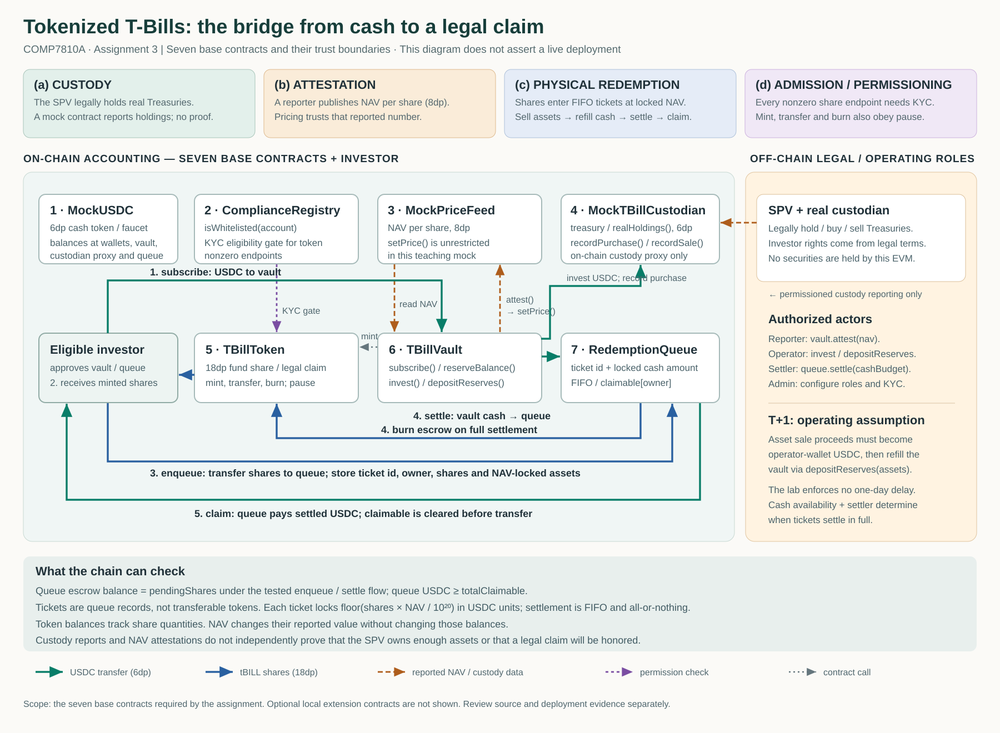

# COMP7810A Assignment Three — RWA Tokenization Lab

<!-- ASSIGNMENT3_CUSTOM_SECTION -->

This project models a tokenized T-Bill fund: 6-decimal MockUSDC cash buys
18-decimal tBILL shares at an 8-decimal reported NAV. Custody, attestation,
physical redemption and admission are separate trust boundaries.

The implementation includes Ex0–Ex6, the optional Ex7 exploit, A–E discussion,
and three separately tested local extensions. All seven base contracts have
been deployed to Ethereum Sepolia and have Etherscan source-code verification
records, as confirmed by the student. All seven authentic verification
screenshots are included in `docs/evidence/` and linked in the evidence index.

## Rubric and deadline

The assignment brief supplied for this work specifies Ex0–Ex6 (40%), seven
Sepolia deployments and verification (20%), A–E discussion (25%), and code and
architecture documentation (15%). Tier 2 is mandatory; optional Tier 3 is
unmarked. Ex1 is the warm-up. The formal PDF was not available in this workspace,
so these weights follow the supplied brief rather than an independent PDF review.
The user reports the extended Moodle deadline as **20 October 2026, 23:55**;
check the course page for its displayed timezone and final submission state.

## Setup and checks

Clone this completed student repository. `lib/` contains the complete lecturer
copies of forge-std and OpenZeppelin v5.0.2; no dependency installation is needed.
Use Foundry **v1.8.3** and Solidity **0.8.24**, as in `.devcontainer/`.

```bash
git clone https://github.com/fionawang666/comp7810a-assignment3.git
cd comp7810a-assignment3
make doctor
make test
make exercise
make challenge
forge test --match-path 'test/tier3/*.t.sol' -vv
forge test
forge fmt --check
python3 scripts/preflight-project.py
python3 scripts/harden-demo-keys.py
python3 scripts/capture-checks.py
```

In the managed cloud session the pinned binaries are already installed; use
`source /workspace/cloud-setup/env.sh` before these commands. Elsewhere install
Foundry through the supplied container or `scripts/install-foundry-cn.sh`.
`FOUNDRY_SOLC` can select an already installed native 0.8.24 compiler when compiler
hosting is unavailable; this session used `/workspace/toolchains/solc-0.8.24`.

`make doctor` and `make test` run the seven original core tests explicitly;
optional suites have their own commands and remain included in `forge test`.
The lecturer's `test/TBill.t.sol` and `test/exercises/02_QueueTasks.t.sol` are
unchanged. The student TODO files contain the completed exercise implementations.

Actual full command output and exit codes are saved in
[docs/submission-checks.txt](docs/submission-checks.txt). Its companion
[JSON record](docs/submission-checks.json) binds the log to the tested source,
config, scripts and complete libraries. `python3 scripts/capture-checks.py
--check-evidence` rejects stale or incomplete evidence. The capture command
continues through failures, records each exit code, and exits nonzero if any
check fails. See [the completion report](docs/completion-report.md) for final
counts, the original two failures, and remaining limitations.

## Architecture



| Contract | Function and trust boundary |
|---|---|
| MockUSDC | Faucet cash for the lab; no real dollar reserve claim |
| ComplianceRegistry | Administrator controlled whitelist |
| MockPriceFeed | Mutable NAV report; its setter is unrestricted in the teaching mock |
| TBillToken | Share balances; whitelist checks apply to mint, transfer and burn |
| MockTBillCustodian | Reported holdings counter; no proof of securities ownership |
| TBillVault | Subscription pricing, reserves, investment and report forwarding |
| RedemptionQueue | Share escrow, enqueue-time NAV, FIFO settlement and USDC claims |

USDC subscription cash goes to the vault; tBILL shares go to the investor.
An enqueue transfers shares to the queue and locks a ticket's USDC payout:
`shares * nav / 1e20`. Settlement consumes whole tickets in FIFO order, draws
vault reserves and burns escrowed shares. Claiming zeroes the investor's credit
before sending USDC. The cash leg models asynchronous T+1 proceeds; no timestamp
forces a one-day wait. Off-chain legal title, segregation, custody and liquidation
are outside these contracts.

The two required invariants are `tBill.balanceOf(queue) == queue.pendingShares()`
and `usdc.balanceOf(queue) >= queue.totalClaimable()`. They check accounting.
They do not prove adequate real assets, legal enforceability, accurate NAV or
redemption liveness. Ex6 also tracks actual state changes and independent ghost
ledgers; a deterministic handler sequence proves enqueue, settlement and claim
execute successfully.

## Ex1 — local Anvil walkthrough

Use [docs/local-walkthrough.md](docs/local-walkthrough.md) and the accompanying
`scripts/local-walkthrough.py`. They deploy all seven contracts on an isolated
local Anvil, fund a user, subscribe, read NAV, escrow shares, settle and claim,
then check the roles, wiring and final accounting. The evidence is explicitly
local. Signing uses Anvil's unlocked accounts; no private key is read or passed.

The Makefile demonstration commands also accept a **public** `ADMIN` address
and use unlocked accounts against `http://127.0.0.1:8545`. `make anvil` suppresses
Anvil's account-secret display. Obtain public account addresses using
`cast rpc eth_accounts --rpc-url http://127.0.0.1:8545`.

## Deployment (Sepolia)

**Mandatory Tier 2 (20%): deployment and source-code verification completed.**

- **Network:** Ethereum Sepolia, chain ID `11155111`.
- **Public deployer:** `0x87b370f0f860831DA4000dDAF742f8fa7fdbB549`.
- **Transactions:** seven contract creations and six role-assignment or wiring
  transactions succeeded, for a total of **13 successful on-chain transactions**.
- **Configuration validation:** `python3 scripts/check-deployment.py --chain-id 11155111`
  passed all **29 on-chain decimal, wiring and permission checks**.
- **Source-code verification:** Etherscan verification records were confirmed
  for all seven deployed contracts.

| Contract | Sepolia address | Etherscan source-code verification |
|---|---|---|
| MockUSDC | `0x25B1A3CAD54102f0c798697057f642fa54215aEC` | [Verified source code](https://sepolia.etherscan.io/address/0x25B1A3CAD54102f0c798697057f642fa54215aEC#code) |
| ComplianceRegistry | `0x82990740bFF5089d66b323cF27187f2d0539A0c4` | [Verified source code](https://sepolia.etherscan.io/address/0x82990740bFF5089d66b323cF27187f2d0539A0c4#code) |
| MockPriceFeed | `0x9603c3E0177FC72b8bB3387761b30bc1619994A5` | [Verified source code](https://sepolia.etherscan.io/address/0x9603c3E0177FC72b8bB3387761b30bc1619994A5#code) |
| TBillToken | `0x99469750CCF235fc004021229274AbE005b75612` | [Verified source code](https://sepolia.etherscan.io/address/0x99469750CCF235fc004021229274AbE005b75612#code) |
| MockTBillCustodian | `0xAebC532482aC32F70568b173f4F1339A7fB65A54` | [Verified source code](https://sepolia.etherscan.io/address/0xAebC532482aC32F70568b173f4F1339A7fB65A54#code) |
| TBillVault | `0xdA9EA7738eF4134ac911b9dBa23012aD69f1d177` | [Verified source code](https://sepolia.etherscan.io/address/0xdA9EA7738eF4134ac911b9dBa23012aD69f1d177#code) |
| RedemptionQueue | `0x66A5f06Ca5709efE50c72206Bbdc4b7AE17A6406` | [Verified source code](https://sepolia.etherscan.io/address/0x66A5f06Ca5709efE50c72206Bbdc4b7AE17A6406#code) |

The deployment and validation results above were supplied and confirmed by the
student. Inspection of the original screenshots shows **Similar Match** for
MockUSDC, ComplianceRegistry, MockPriceFeed, TBillToken, MockTBillCustodian and
TBillVault, and **Exact Match** for RedemptionQueue. These classifications
transcribe the visible screenshot labels rather than infer a uniform status.

All seven original Etherscan screenshots were committed in `bdc8dc1`. Each link
in the [evidence index](docs/evidence/README.md) resolves to an existing PNG;
the displayed contract addresses match the deployment table above.
The original screenshot files are unchanged by this documentation review.

[docs/deployment-sepolia.md](docs/deployment-sepolia.md) records the completed
deployment and retains the earlier simulation, deployment and source-verification
commands as historical reproducibility instructions. These commands do not
require redeploying the contracts listed above. No transactions were broadcast
and no on-chain configuration checks were rerun during this documentation-only
update. The previously recorded Anvil addresses remain local demonstration data.

## Optional work and teaching limitations

Ex7 retains the original challenge conditions: a whitelisted attacker uses the
reporting power to overvalue their redemption and extracts reserve cash, leaving
honest holders underbacked. The base mock feed also allows direct `setPrice` calls;
`REPORTER_ROLE` on `vault.attest` alone is not end-to-end oracle authorization.

`src/tier3/` stays separate from the seven base contracts:

- `NavSafetyReader` checks age, future/zero timestamps, positive answers, complete
  rounds and decimal normalization. `GuardedSubscriptionVault` applies those
  checks before issuing subscription shares. This does not retrofit the base
  redemption queue or establish economically correct NAV.
- `RegulatedTransferPolicy` and `RegulatedTBillToken` model identity enrollment and
  freezing. They are ERC-3643-inspired local prototypes, with no certification or
  complete ERC-3643 identity/recovery system.
- `ChainlinkNavAdapter` wraps an AggregatorV3-compatible interface. Tests use a mock;
  no live Treasury NAV source is configured. ETH/USD is not a T-Bill NAV.

The teaching contracts are not production fund infrastructure. The whitelist and
pause rules can block escrow and settlement; already settled USDC credits can
still be claimed during a token pause. A direct share transfer to the queue can
break the exact escrow equality outside the handler's modeled enqueue workflow.
Checked arithmetic reverts on unrealistic large multiplication rather than using
full-precision multiplication; fractional USDC payouts round down. These limits
are documented, not hidden by changing the lecturer's model.

## Submission preparation

`STUDENT-QUESTIONS.md` preserves the original questions and supplies the eight
150–300 word answers, seven genuine Ex2–Ex4 test names and an additional attack.
The architecture shows all seven contracts and all four bridge planks.

```bash
python3 scripts/audit-submission.py
python3 scripts/package-submission.py
```

The audit checks the seven deployment rows, matching explorer links, written
answers and the integrity of the existing Foundry evidence. Documentation-only
changes do not alter the source snapshot to which that evidence is bound.
The exact results of the checks requested for this update are recorded in
[the completion report](docs/completion-report.md) and the
[evidence index](docs/evidence/README.md).

The seven authentic screenshots have been checked directly for file presence,
contract address and the visible match classification. The automated audit
alone does not perform those image checks or establish a current live explorer
status. Review the indexed evidence and the complete submission against the
assignment PDF before packaging.

The package retains `lib/` and excludes Git history, build caches, broadcast
files, `.env*`, wallet or keystore files, credentials and other archives. No final
ZIP has been created and nothing has been submitted to Moodle during this
update. Review the final archive and confirm the Moodle submission state
personally before the course deadline.
